<p align="center"></p>

# SAXS Projects — Business Website

The official website of **SAXS Projects**, a South African software studio building web apps, automation and tech solutions for businesses and students.

**Live site:** https://www.saxsprojects.co.za

## Features

- Marketing pages: Home, Services, Tech Solutions, Student Services, How We Work, Pricing, About, Blog and Contact
- Client dashboard with Google sign-in (OAuth callback flow)
- Floating WhatsApp contact button
- Optional Node.js/Express backend for clients, projects, invoices, email and calendar integrations

## Tech stack

| Layer    | Tools |
|----------|-------|
| Frontend | React 19, Vite, React Router, lucide-react |
| Backend  | Node.js, Express, MongoDB (Mongoose), Firebase Admin, Google APIs, Nodemailer |
| Hosting  | Vercel (frontend) |

## Getting started

Requirements: Node.js 20 or newer and npm.

```bash
git clone https://github.com/SaxsProjects/saxsprojectsweb.git
cd saxsprojectsweb
npm ci
npm run dev        # http://localhost:5173
```

Other scripts:

```bash
npm run build      # production build into dist/
npm run preview    # serve the production build locally
npm run lint       # ESLint
```

### Backend (optional)

```bash
cd backend
npm ci
npm start
```

The backend reads its configuration from environment variables in `backend/.env` (never commit this file). Variables used: `PORT`, `MONGODB_URI`, `ADMIN_EMAIL`, `INQUIRY_RECIPIENT_EMAIL`, `SMTP_HOST`, `SMTP_PORT`, `SMTP_USER`, `SMTP_PASS`, `SMTP_FROM`, `GOOGLE_CLIENT_ID`, `GOOGLE_CLIENT_SECRET`, `GOOGLE_REDIRECT_URI`, `GOOGLE_SERVICE_ACCOUNT_EMAIL`, `GOOGLE_PRIVATE_KEY`, `GEMINI_API_KEY`.

More detail: [BACKEND_GUIDE.md](BACKEND_GUIDE.md), [TESTING.md](TESTING.md), [QUICK_REFERENCE.md](QUICK_REFERENCE.md).

## Project structure

```
src/
  pages/        site pages (Home, Services, Pricing, ...)
  components/   shared components (WhatsApp button, Google login)
  assets/       logos and images
backend/        Express API, Mongoose models, integrations
public/         static files
```

## Contributing

Issues and pull requests are welcome. See the organisation's [contributing guide](https://github.com/SaxsProjects/.github/blob/main/CONTRIBUTING.md) and report security issues privately as described in [SECURITY.md](https://github.com/SaxsProjects/.github/blob/main/SECURITY.md).

## Contact

- Website: https://www.saxsprojects.co.za
- Email: saxsprojects.dev@gmail.com

© SAXS Projects. All rights reserved.
